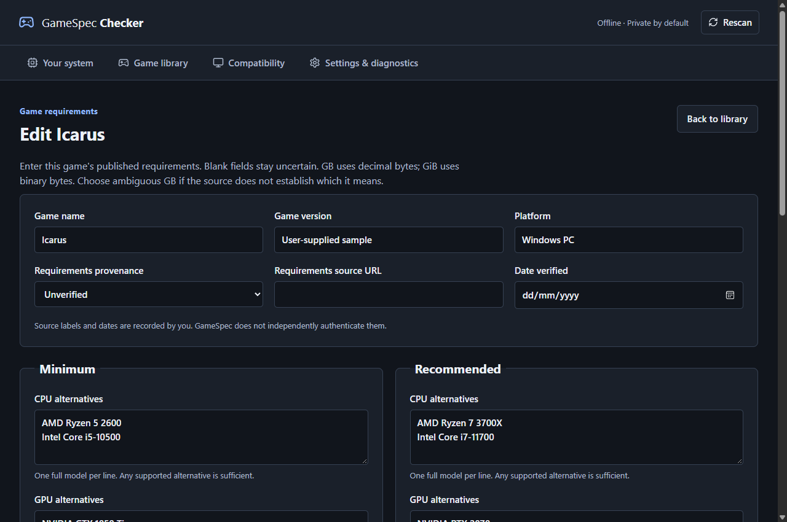
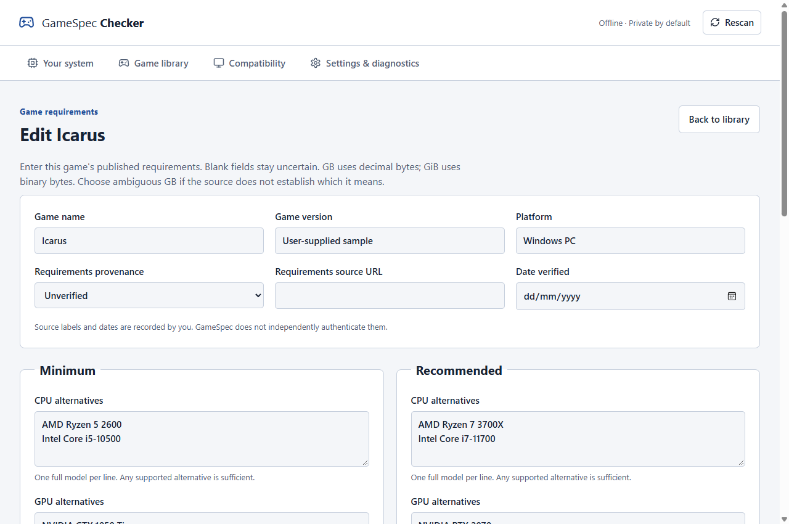

# GameSpec Checker

An offline Windows desktop application that inspects real hardware and compares
it with game requirements entered by the user. Rust owns scanning, profiles,
compatibility and graphics heuristics. Tauri 2 and React provide the desktop UI.
The CLI calls the same assessment engine.

This branch is an engineering overhaul in progress. It fixes profile creation,
units, evidence boundaries, verdict aggregation and the interface. It does **not**
yet fulfil the performance coverage acceptance criterion. The bundled catalogue
contains 52 hardware identities and **zero decision-eligible benchmark measurements**.
Cross-model comparisons remain uncertain until suitable evidence is installed.
Do not treat this as a completed production release.

See the [audit](docs/overhaul-audit.md), [validation record](docs/validation.md)
and [continuation plan](docs/continuation.md).

## Windows installation

Supported target: Windows 10/11 x64 with Microsoft Edge WebView2. The current-user
NSIS installer and normal operation require no administrator access. Builds are
unsigned. WebView2 must be installed; setup can download its bootstrapper if needed.
Runtime scanning, local profiles and assessment work offline.

Download build artifacts from the existing Windows production workflow when its
run has succeeded. A published GitHub release is a separate delivery step; no
release is implied by a workflow definition or successful compilation.

## Using the application

1. Review Your system. Dedicated VRAM is reported separately from physical RAM.
2. Create a blank game profile or import JSON. Enter a real game/version/platform,
   alternatives, capacities with units, source URL and verification date. Imported
   profiles receive a new ID and open for review before saving.
3. Choose the game, intended GPU, installation drive or absolute destination, and
   connected display/output resolution. Multi-GPU selection is explicit.
4. Run the assessment. Minimum and recommended each show confirmed passes,
   confirmed failures and missing evidence. Expand components for sources,
   confidence and technical explanations. SSD advice is separate from mandatory SSD.
5. Review installation space and remaining headroom. No game is installed and no
   files or disk partitions are changed.
6. Try the generic initial graphics suggestions. Optionally provide measured FPS
   and a target to guide another trial. The app makes no frame-rate prediction.

Search, edit, duplicate, remove and export profiles in the game library. Removal
requires confirmation in the app. Copy/export the full assessment as JSON.
Settings includes theme selection, local catalogue preview/update/reset and
hardware diagnostics export. Dark, light and Windows appearance are supported.

The editable Icarus sample comes from the project request, not a verified official
requirements source. Source labels are supplied by profile authors. Even a label
of official does not mean GameSpec authenticated it.

## Evidence and limitations

- Models are identified by conservative normalisation and explicit aliases.
  Variant suffixes remain distinct. Model numbers, generations, clocks, prices
  and vendor names never rank performance.
- Comparison datasets declare workload, metric, direction, test context,
  publication date, source, methodology, uncertainty and redistribution license.
  Both devices must have intervals in the same dataset. Overlap, disagreement,
  missing evidence or uncleared data stays Unknown. Different workloads and
  scales are never substituted. A passing alternative is sufficient; failure
  requires evidence against every alternative.
- The old six synthetic scores were removed because redistribution rights were
  not established. Blender's CC0 rendering data does not establish gaming
  performance; openly licensed estimated tiers reviewed so far do not supply
  comparable measurements. See [benchmark research](docs/overhaul-audit.md).
- The engine supports cross-vendor measurements, but the bundled baseline cannot
  yet decide Ryzen 5 3600 versus the Icarus CPUs, or RX 7600 versus its NVIDIA GPUs.
  Hardware identity coverage is not benchmark coverage.
- GB is 1,000,000,000 bytes; GiB is 1,073,741,824 bytes. Requirements retain their
  selected units. Ambiguous GB uses both bounds: between them remains uncertain.
  DXGI-reported 8,528,596,992 bytes meets 8 GB, falls below 8 GiB, and is uncertain
  for ambiguous 8 GB. Marketed capacity is not inferred by rounding API results.
- DXGI DedicatedVideoMemory supplies VRAM. Shared memory, physical RAM and WMI's
  truncated AdapterRAM are never substituted. Advertised capacity metadata is
  supported in the catalogue, but official specifications are not yet populated.
- Direct3D 12 device support and feature levels are probed on the selected adapter.
  Vulkan, OpenGL, ray-tracing features, DLSS/FSR/XeSS integration and frame
  generation are not verified. No enabled upscaler is recommended without checks.
- SSD/HDD can be unknown for RAID, USB and virtual storage. Destination resolution
  follows existing ancestors, junctions and mount points. Free space is a snapshot;
  optional installation headroom is advisory and cannot predict update size.
- Graphics recommendations are generic heuristics using independent CPU/GPU
  evidence, requirements-relative VRAM, available RAM, resolution and measurements.
  No game-specific presets are claimed. Storage failures do not change quality.

## Local data and migration

Profiles are saved under the Tauri application data directory, normally
`%APPDATA%\io.github.jcodog.gamespec\profiles`. A reviewed custom catalogue is
`catalog.json` in the parent directory. `GAMESPEC_DATA_DIR` can select an absolute
alternative directory at launch for isolated verification or portable use.
Theme preference remains in the WebView's local storage.

Schema 1 profiles migrate in memory. Their existing GiB values are preserved,
and a warning asks the user to review units and possible Icarus template copying.
The application never silently changes an AION 2 profile into a different game.
Save writes schema 2. Back up old profiles before saving or downgrading: the old
application cannot read schema 2. Corrupt files are isolated and reported without
preventing healthy profiles from loading. Icarus is seeded once and may be removed.

Catalogue imports are bounded and validated, then shown for review. Validation
cannot authenticate license claims or benchmark methodology. Only install data
whose sources, intervals and reuse permission you have checked. There is no
scraping, automatic online refresh or hardware upload.

No telemetry, accounts or advertisements. Exports include hardware and local
paths; review them before sharing. Export writes to a user-selected native Save
dialog destination. Source URLs can be copied for independent review.

## Development

Install Rust stable with x64 MSVC Windows C++ Build Tools, WebView2 and Bun 1.3.14.
Use the committed Cargo.lock and bun.lock; no competing package manager.

```powershell
bun install --frozen-lockfile
bun run desktop
bun run desktop:build
cargo build --release -p gamespec-cli --locked
```

Desktop: `target/release/gamespec-checker.exe`. CLI: `target/release/gamespec.exe`.
Installer: `target/release/bundle/nsis/*-setup.exe`. Browser previews cannot scan
hardware and show an explicit native-runtime error.

```powershell
cargo fmt --all -- --check
cargo test --workspace --locked
cargo clippy --workspace --all-targets --locked -- -D warnings
bun run lint
bun run typecheck
bun run test
bun run build
```

Windows CI runs these checks and builds the desktop executable. The production
workflow also builds the current-user installer, CLI and SHA-256 checksums.
Successful compilation alone does not verify installation or application behaviour.

## CLI

```powershell
gamespec scan --output system.json
gamespec check data/icarus.json --path "D:\Games\Icarus" --gpu "ADAPTER_ID"
gamespec report data/icarus.json --path "D:\Games\Icarus" --gpu "ADAPTER_ID" --output report.json
gamespec --catalog reviewed-catalog.json check data/icarus.json --path "D:\Games\Icarus"
```

Get IDs from scan. With one GPU the CLI selects it; with several, GPU checks stay
uncertain unless selected. Invalid profiles, locations and catalogues exit 1.
Below-minimum and uncertain assessments are valid JSON reports. From source,
use `cargo run -p gamespec-cli --` before the command.

## Real desktop verification

Use a dedicated test instance to avoid changing your own profiles. Node executes
the installed Playwright test transport because Bun's CDP WebSocket connection
failed in this environment. Bun remains the package manager and script launcher.

```powershell
$env:GAMESPEC_DATA_DIR = "$PWD\.local\desktop-test-data"
$env:WEBVIEW2_USER_DATA_FOLDER = "$PWD\.local\desktop-test-webview"
$env:WEBVIEW2_ADDITIONAL_BROWSER_ARGUMENTS = "--remote-debugging-port=9223"
Start-Process -WindowStyle Hidden target/release/gamespec-checker.exe
$env:GAMESPEC_CDP_URL = "http://127.0.0.1:9223"
bun run test:desktop
```

For full restart persistence, run `node scripts/verify-restart.mjs prepare`,
close and relaunch the dedicated test instance with the same data/environment,
then run `node scripts/verify-restart.mjs verify`.

This test uses the actual Tauri IPC and scanner. It checks blank creation,
editing, reload persistence, search, import isolation, removal, assessments,
measured tuning, themes, catalogue validation/review and layout overflow. Local
screenshots and reports stay in ignored `.local/`. Remove debugging environment
variables and close the test instance after verification. Debugging is only for
local testing. The test directory should be fresh.

## Screenshots

These show the actual installed requirements editor for the overhaul stage.





## Structure and licence

`crates/gamespec-core` holds models, scanner, catalogue, profiles, pure assessment
and separate recommendations. `crates/gamespec-cli` and `src-tauri` are adapters.
`src` contains typed IPC, application state, requirements editor and report views.
`data` is the bundled baseline. `docs` records architecture, audit and validation.

Code is MIT licensed. A code licence never grants rights to third-party benchmark
articles, charts or databases.
